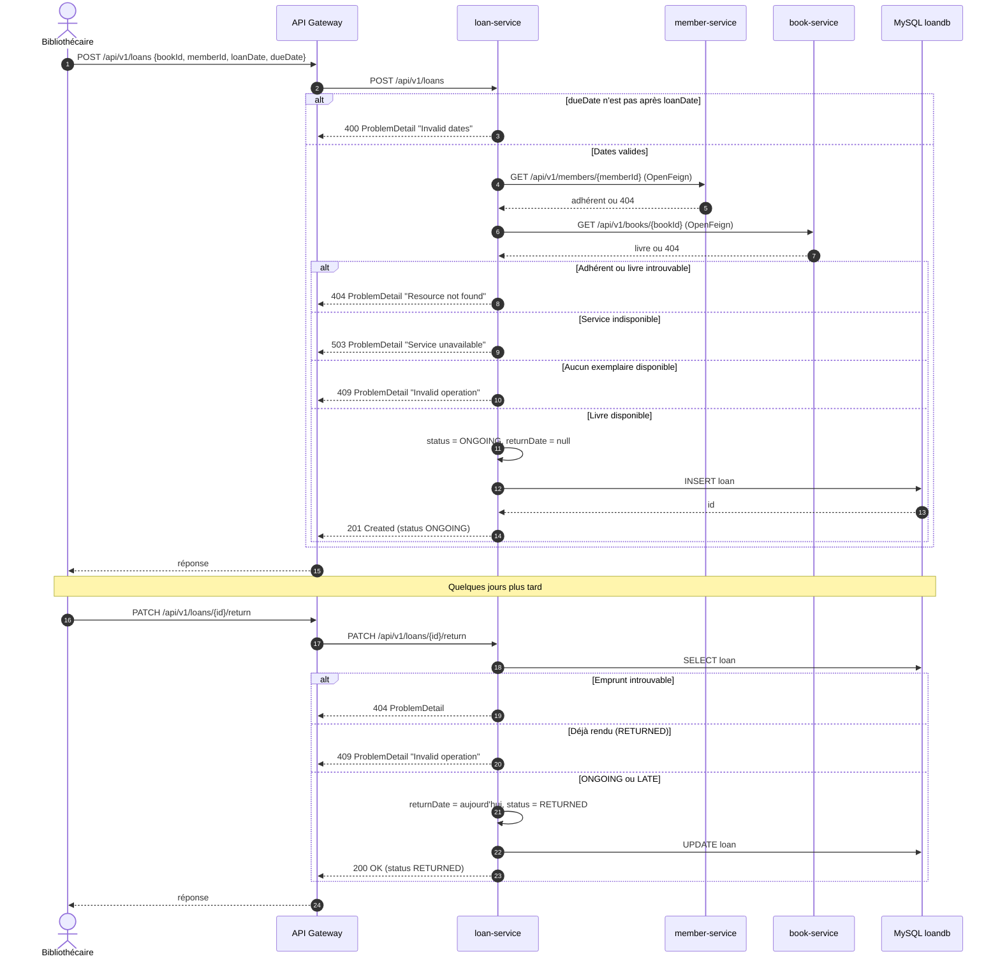

# Diagramme de séquence : emprunt puis retour d'un livre

Un adhérent emprunte un livre puis le rend. Avant d'enregistrer l'emprunt, `loan-service` vérifie l'adhérent et le livre en appelant `member-service` et `book-service` avec **OpenFeign** (résolution des noms via Eureka). Il stocke uniquement `bookId` et `memberId`.

